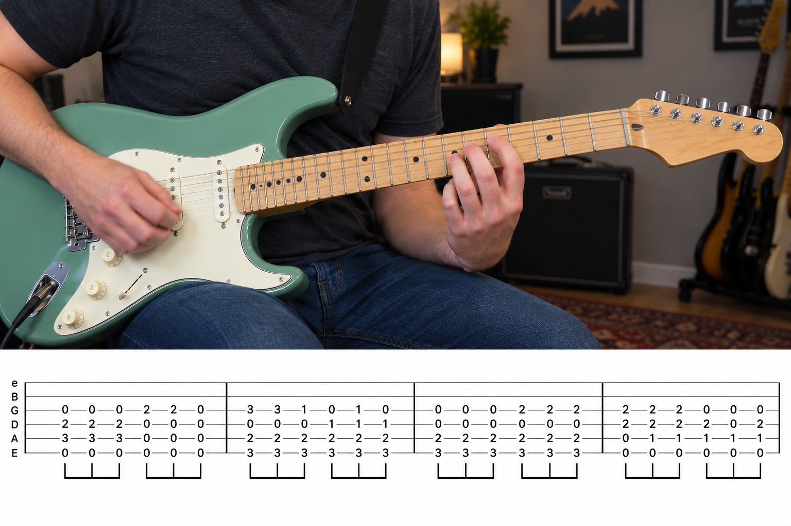
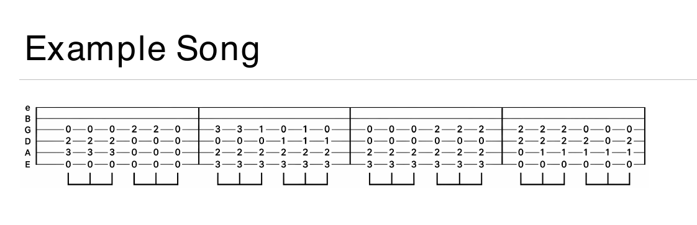

# youtabber

Turns a YouTube play-along video into a printable PDF of the tab.

| Video | PDF |
|---|---|
|  |  |

```sh
youtabber "https://www.youtube.com/watch?v=..."
```

It finds the tab on screen, wipes out the moving cursor, and pieces the whole song together, whether
the video shows one line at a time or scrolls forward. Tab at the bottom, at the top, or in a box all
work. (The frame above is made up, not from a real video.)

## Install

You'll need [uv](https://docs.astral.sh/uv/) and [ffmpeg](https://ffmpeg.org/) (`brew install ffmpeg`).

```sh
git clone https://github.com/brennanpowers/youtabber.git
uv tool install --editable ./youtabber
```

## Usage

```sh
youtabber URL                          # writes out/<song-name>/<song-name>.pdf
youtabber song.mp4                     # a local video works too
youtabber URL --title "Song - Artist"  # when the name pulled from the video title is wrong
youtabber URL --region 370,712,1546,364  # when it picks up something that isn't the tab
youtabber URL --passes all             # print every pass of a replayed section
youtabber URL --no-enhance             # skip sharpening, for a smaller file
```

The output folder holds the PDF, `meta.json` (what was read, with times), `measures/` (one image per
printed measure), and `views/` (each screen it read, with the measures it found boxed), so you can check a
PDF that looks wrong against the video.

`--region` is x,y,width,height in video pixels. To find it, look in `meta.json` under `segments[].crop`
for the box it used last time, and adjust that.

It exits with 0 when the PDF is clean, 1 when no PDF was made, 2 for bad arguments (such as a
`--region` outside the video), 3 when the PDF has spots to check (listed on its last page) or a second
PDF was written with replayed sections printed once, and 130 when stopped with Ctrl-C.

Piped or redirected, it prints plain `key: value` lines, one fact per line, for scripts:

```sh
youtabber URL | grep '^pdf:'           # just the PDF paths
```

```
title: Slipknot – Before I Forget PoV - SCREEN
stage: finding the tab
...
pdf: out/slipknot-before-i-forget-pov-screen/slipknot-before-i-forget-pov-screen.pdf
check: 0:02-0:06 A measure around 0:04 is much wider than the others; a barline may have been missed there.
status: check
```

The keys are `source`, `title`, `credit`, `length`, `stage`, `read`, `pdf`, `copied`, `check` (each spot
to check), `note` (a repeat the folded PDF prints once), `status` (`ok`, `check` or `failed`) and, when
no PDF was made, `reason`. Errors go to stderr. Set `NO_COLOR` to turn off colour in the terminal.

Videos are cached in `~/.cache/youtabber`, so a second run doesn't download again.

## Config

`~/.config/youtabber/config.toml`:

```toml
pdf_dir = "~/Documents/tabs"   # also copy every PDF here
model = "realesrgan-anime"     # sharper output, see below
enhance = false                # skip sharpening unless --enhance or --model is passed
passes = "all"                 # print every pass instead of folding replays
```

## Sharper output

By default the tab is upscaled and sharpened with ordinary image filters. For cleaner notes, it can
use [Real-ESRGAN](https://github.com/xinntao/Real-ESRGAN)'s line-art model instead. That needs
PyTorch, which is a big download, so it's an optional extra:

```sh
uv tool install --editable './youtabber[ai]'
youtabber URL --model realesrgan-anime
```

It adds a few seconds to a minute per song. The model downloads on first use. `--model` also takes
a path to any model file [spandrel](https://github.com/chaiNNer-org/spandrel) can load, or `classic`
to skip the model your config names. These models can invent detail, so check a new one against the
video before trusting it.

## How it works

It finds the tab by the long, evenly spaced lines of its staff. Each screen that holds still becomes
one clean image with the cursor taken out, and tab that slides smoothly past a fixed line is stitched
into one long image. Each image is cut at its barlines into measures, and the measure numbers above
them are read. Each measure is placed in the song once, and a section shown again is printed once
only when the video shows it's a replay, such as matching measure numbers, a repeat sign, or a D.S.
marking. When it can't tell, it prints the section every time and writes a second PDF that prints
it once.

It would rather say so than print wrong tab. Anything it isn't sure of is listed as a spot to check on the
PDF's last page, and when it can't trust a reading at all (tab shown only for a moment, too little of it
read, or several parts it can't tell apart) it makes no PDF and says why.

## Known gaps

- A video that shows one page of tab the whole time may need `--region`.
- If downloads start failing, YouTube probably changed something. `uv tool upgrade youtabber` pulls
  the latest [yt-dlp](https://github.com/yt-dlp/yt-dlp).
- Text tab (`e|--3--`), tab drawn see-through over the video, and tab drawn without barlines aren't read.
- Light gray barlines on light paper can be missed, so two bars print as one. These usually show up as
  spots to check: a faint line that may be a barline.
- Split screens are read panel by panel, but one whose full width doesn't hold still, such as tracks
  moving between panels, is refused, or left out when it isn't the main part. Two bands of tab playing
  different parts are refused when their screens can't be put in order.
- A compilation of several songs prints as one PDF, without song labels.

## Please be nice

Use it with videos you have the right to use: your own, Creative Commons ones, or ones whose creator
is fine with it. The tabs belong to whoever transcribed them, so keep the PDFs for your own practice,
and follow YouTube's terms. Support the channels you learn from.

## License

[MIT](LICENSE)
